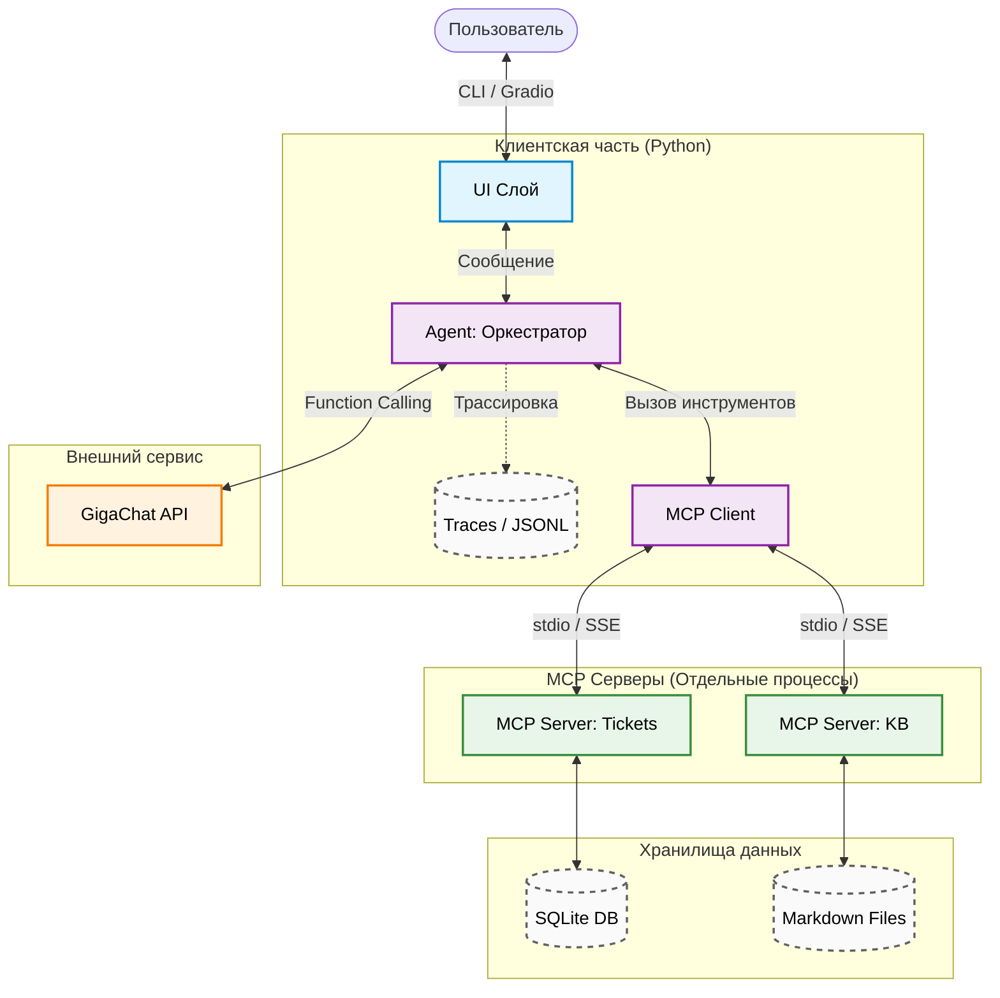

# MCP-ассистент инженера поддержки

Интеллектуальный ассистент на базе GigaChat и протокола Model Context Protocol (MCP). Умеет искать тикеты в базе данных (БД), работать с базой знаний (md-файлы), изменять статусы тикетов и добавлять к ним комментарии, запрашивая подтверждение на выполнение этих действий.

## Быстрый старт

### 1. Требования
*   Python 3.12+
*   Пакетный менеджер [uv](https://docs.astral.sh/uv/)
*   Ключ авторизации GigaChat (получить можно в [личном кабинете](https://developers.sber.ru/portal/products/gigachat-api))
*   ~3 ГБ свободного места для зависимостей (включая PyTorch)

### 2. Установка
Склонируйте репозиторий и установите зависимости:
```bash
git clone <url_вашего_репозитория>
cd mcp_assistant
uv sync     # Первый запуск может занять 5-10 минут (скачивается PyTorch)
```

### 3. Настройка
Создайте файл `.env` в каталоге `mcp_assistant` и заполните его на основе примера, приведенного в файле `.env.example`

### 4. Инициализация базы данных
Данные о тикетах хранятся в SQLite БД `tickets.db` в следующих таблицах:\
`tickets(id, subject, body, status, priority, client, created_at, updated_at, tags)`\
`messages(id, ticket_id, author, text, created_at)`\
`logs(id, ticket_id, level, message, created_at)`\
Для заполнения БД тестовыми тикетами выполните в каталоге `mcp_assistant` команду:\
`uv run python -m src.scripts.seed`\
После выполнения этой команды в каталоге `mcp_assistant` будут созданы:
* каталог `data`, содержащий
  * `tickets.db` - файл SQLite БД
  * `kb/*.md` - каталог с md-файлами базы знаний
* каталог `traces` - каталог для хранения JSONL-файла трассировки сессии (пример записи сессии в файле `example_session.jsonl`)

Для удаления старых данных и пересоздания БД и базы знаний выполните:\
`uv run python -m src.scripts.seed --reset`

### 5. Запуск
1. Запуск Streamable HTTP сервера:
```bash 
uv run python -m src.servers.knowledge
```
2. Запуск агента в одном из двух интерфейсов:
  * веб-интерфейс (Gradio)
    ```bash
    uv run python -m src.client.main --ui gradio [--host HOST] [--port PORT]
    ```
    По умолчанию HOST = 127.0.0.1, PORT = 7860\
    Откройте в браузере: http://127.0.0.1:7860
  * консольный интерфейс (CLI)
    ```bash
    uv run python -m src.client.main --ui cli
    ```

**Пример использования консольного интерфейса:**

```text
============================================================  
MCP-агент готов. Введите запрос или /exit для выхода.
============================================================

Вы: Привет

Агент: Здравствуйте! Я помогу вам найти информацию в базе тикетов или базе знаний. С чем нужна помощь?

Вы: Найди тикет 1 и выведи его содержимое

Агент: Тикет 1:

**Тема:** Ошибка 502 при оплате
**Описание:** При попытке оплаты возникает 502 Bad Gateway
**Статус:** open
**Приоритет:** high
**Клиент:** Globex
**Дата создания:** 2026-10-15T10:00:00
**Дата обновления:** 2026-10-15T10:00:00
**Теги:** payment,502
**Тип проблемы:** bug

Вы: /exit
Выход.
```

## Архитектура

Проект построен по клиент-серверной архитектуре с использованием протокола MCP. Агент выступает в роли оркестратора, который связывает LLM и внешние инструменты.



## Запуск unit-тестов
### Все тесты
```bash
uv run pytest -vv
```

### Только тикеты (без MCP-слоя)
```bash
uv run pytest tests/test_tickets.py -vv
```

### Только база знаний статей (без MCP-слоя)
```bash
uv run pytest tests/test_knowledge.py -vv
```

### Только MCP-интеграция
```bash
uv run pytest tests/test_mcp_layer.py -vv
```

### Только агент
```bash
uv run pytest tests/test_agent.py -vv
```

## Запуск evals

Проект содержит фреймворк для автоматической оценки качества агента.\
Запуск сценариев:
```bash
uv run python evals/run_evals.py [--scenario SCENARIO] [--file SCENARIO_FILE] [--runs RUNS]
```
При запуске можно указать ID конкретного сценария (`--scenario SCENARIO`), имя YAML-файла со сценариями (`--file SCENARIO_FILE`, по умолчанию - `evals/scenarios.yaml`) и/или количество прогонов на сценарий (`--runs RUNS`, по умолчанию - 3)
По итогам тестов выводится информация о стабильности (Success Rate), точности выбора инструментов и среднем количестве шагов. Пример вывода результатов приведен в файле `EVALS.md`.

## Технологический стек

**Клиент:**
* `gigachat` — официальный SDK для GigaChat
* `gradio` — веб-интерфейс
* `mcp[cli]` — клиент протокола MCP

**Агент и инструменты:**
* `anyio` — асинхронный рантайм
* `sentence-transformers` — эмбеддинги для поиска по базе знаний
* `python-dotenv` — конфигурация через `.env`
* `pyyaml` — сценарии Evals

**Тесты:**
* `pytest`, `pytest-asyncio` — unit-тесты

## Известные ограничения
* Проблемы с параллелизмом (многопользовательский режим): В текущей реализации один экземпляр MCPClient создается при старте приложения и живет все время. Если одновременно работают несколько пользователей в Gradio, они могут мешать друг другу при работе со stateful-инструментами.

* SQLite блокировки: При очень интенсивных параллельных запросах SQLite может выдавать ошибку database is locked. Для продакшена рекомендуется перейти на PostgreSQL.

* Контекстное окно: Если агент делает слишком много шагов (вызовов инструментов), история сообщений может превысить контекстное окно GigaChat. Сейчас это ограничено параметром max_steps=8 в конфиге.

* Отсутствие стриминга: Агент возвращает ответ целиком, а не по токенам. Из-за этого в Gradio пользователь видит только «крутящийся спиннер», пока агент думает.

* Tracer пишет в session.jsonl. В CLI одна сессия = один файл. В Gradio все сессии пишут в один файл, в результате строки разных сессий перемешиваются.
 
* инструмент search_tickets (сервер tickets) ищет тикеты только с одним значением статуса, приоритета и/или клиента

* в evals используются md-файлы из продуктовой базы знаний


